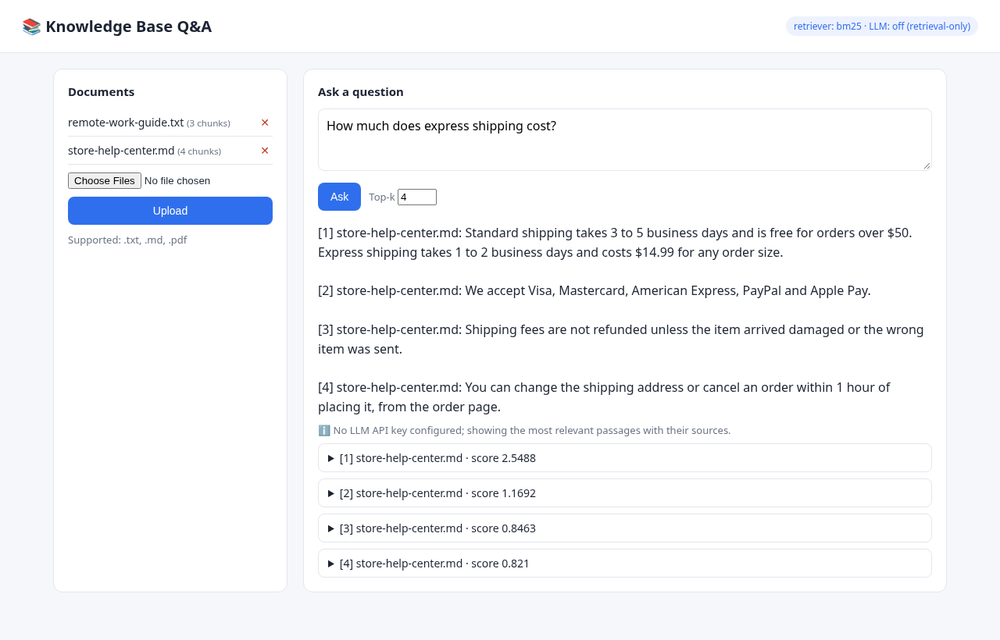

# Knowledge Base Q&A — a small, practical RAG chatbot

Ask questions about your own documents (`.txt`, `.md`, `.pdf`) and get answers **with cited sources**.
Runs fully locally with no paid API by default; plug in any OpenAI-compatible LLM when you want generated answers.



## Features

- **Upload documents** through the web UI or drop them into `data/docs/` (txt, md, pdf).
- **Paragraph-aware chunking** with configurable size and overlap.
- **Local retrieval, zero cost:** Okapi BM25 implemented in pure Python, with CJK bigram tokenization so Chinese text works too.
  Optional dense retrieval with `sentence-transformers` (also local and free).
- **Pluggable LLM:** any OpenAI-compatible `/chat/completions` endpoint (OpenAI, Azure-compatible gateways, OpenRouter, a local Ollama / vLLM server, ...), set with environment variables.
- **Graceful fallback:** with no API key, or if the LLM call fails, the bot returns the most relevant sentences from the top passages and labels each with its source file.
- **Source citations:** every answer lists the passages it used, with file name, chunk id and score.
- **REST API + simple web UI + CLI**, with 17 unit tests.

## Architecture

```
            ┌──────────────┐   upload / folder   ┌───────────┐   chunks   ┌─────────────────┐
  user ───► │ FastAPI app  │ ──────────────────► │  loaders  │ ─────────► │ chunker         │
  (web/CLI) │ app/main.py  │                     │ txt/md/pdf│            │ paragraph-aware │
            └──────┬───────┘                     └───────────┘            └────────┬────────┘
                   │ question                                                      │ index
                   ▼                                                               ▼
            ┌──────────────┐  top-k passages  ┌───────────────────────────────────────────┐
            │ RAGPipeline  │ ◄─────────────── │ Retriever: BM25 (default) | embeddings     │
            │ rag/pipeline │                  └───────────────────────────────────────────┘
            └──────┬───────┘
                   │ context + question
                   ▼
            ┌───────────────────────────┐   no key / error   ┌──────────────────────────────┐
            │ LLM (OpenAI-compatible)   │ ─────────────────► │ extractive answer + sources  │
            └───────────────────────────┘                    └──────────────────────────────┘
```

| Path | Purpose |
|---|---|
| `rag/loaders.py` | Text extraction from txt / md / pdf (`pypdf`) |
| `rag/chunker.py` | Paragraph-aware chunking with overlap |
| `rag/retriever.py` | `BM25Retriever` (pure Python) and optional `EmbeddingRetriever` |
| `rag/llm.py` | Minimal OpenAI-compatible client (`httpx`), configured from env vars |
| `rag/pipeline.py` | Ingest → retrieve → generate, with retrieval-only fallback |
| `app/main.py` | FastAPI REST API and static web UI |
| `app/static/index.html` | Single-file web UI (no build step) |
| `cli.py` | Command-line interface (`ask` / interactive `chat`) |
| `data/docs/` | Fictional sample documents loaded at startup |
| `tests/` | pytest suite (chunking, retrieval, pipeline, LLM mocking, API) |

## Quick start

Requires Python 3.10+.

```bash
python -m venv .venv
source .venv/bin/activate          # Windows: .venv\Scripts\activate
pip install -r requirements.txt

uvicorn app.main:app --reload --port 8000
# open http://localhost:8000
```

Tip: `http://localhost:8000/?q=How%20do%20returns%20work%3F` opens the UI and asks the question right away.

### Enable LLM answers (optional)

```bash
# the app reads environment variables; .env.example lists them all
export LLM_API_KEY=sk-...
export LLM_BASE_URL=https://api.openai.com/v1   # any OpenAI-compatible endpoint
export LLM_MODEL=gpt-4o-mini
uvicorn app.main:app --port 8000
```

Local model example (Ollama): `LLM_BASE_URL=http://localhost:11434/v1 LLM_API_KEY=ollama LLM_MODEL=llama3.1`.

### Dense embeddings (optional)

```bash
pip install sentence-transformers
RAG_RETRIEVER=embedding uvicorn app.main:app --port 8000
```

### CLI

```bash
python cli.py ask "How much does express shipping cost?"
python cli.py ask "How big is the home office budget?" --top-k 2 --json
python cli.py chat --docs path/to/your/folder
```

## REST API

| Method | Endpoint | Description |
|---|---|---|
| GET | `/api/health` | Retriever type and whether an LLM is configured |
| GET | `/api/documents` | Indexed documents and chunk counts |
| POST | `/api/documents` | Upload one or more files (`multipart/form-data`, field `files`) |
| DELETE | `/api/documents/{source}` | Remove a document from the index |
| POST | `/api/ask` | `{"question": "...", "top_k": 4}` → answer, mode, note, sources |

Interactive docs are at `/docs` (Swagger UI).

Example response (retrieval-only mode):

```json
{
  "question": "How much does express shipping cost?",
  "answer": "[1] store-help-center.md: ... Express shipping takes 1 to 2 business days and costs $14.99 for any order size.",
  "mode": "retrieval-only",
  "note": "No LLM API key configured; showing the most relevant passages with their sources.",
  "sources": [{"n": 1, "source": "store-help-center.md", "chunk_id": "store-help-center.md#0", "score": 2.55, "text": "..."}]
}
```

## Tests

```bash
pytest -q
```

The suite covers chunking edge cases, BM25 ranking (English and Chinese), re-ingesting a document, the retrieval-only fallback,
the LLM request format (using `httpx.MockTransport`, so no network or key is needed), LLM-failure fallback, PDF loading and the REST API.

## Configuration

| Variable | Default | Meaning |
|---|---|---|
| `LLM_API_KEY` / `OPENAI_API_KEY` | empty | Enables LLM answers when set |
| `LLM_BASE_URL` | `https://api.openai.com/v1` | OpenAI-compatible base URL |
| `LLM_MODEL` | `gpt-4o-mini` | Model name sent to the endpoint |
| `RAG_RETRIEVER` | `bm25` | `bm25` or `embedding` |
| `RAG_DOCS_DIR` | `data/docs` | Folder indexed at startup |
| `RAG_MAX_UPLOAD_MB` | `10` | Upload size limit per file |

## Limitations and next steps

- The index lives in memory; uploads are lost on restart. A persistent vector store (SQLite/pgvector/Chroma) is the natural next step.
- Scanned PDFs need OCR; only PDFs with a text layer are supported.
- No authentication: run it on a trusted network or put it behind an auth proxy.
- Possible extensions: hybrid BM25 + embedding ranking, streaming answers, conversation memory, Docker image.

## Screenshots

- `docs/screenshots/web-ui.png` — web UI answering from the sample documents in retrieval-only mode.
- _Placeholder:_ add a screenshot with an LLM key configured (`docs/screenshots/web-ui-llm.png`).

## License

MIT
